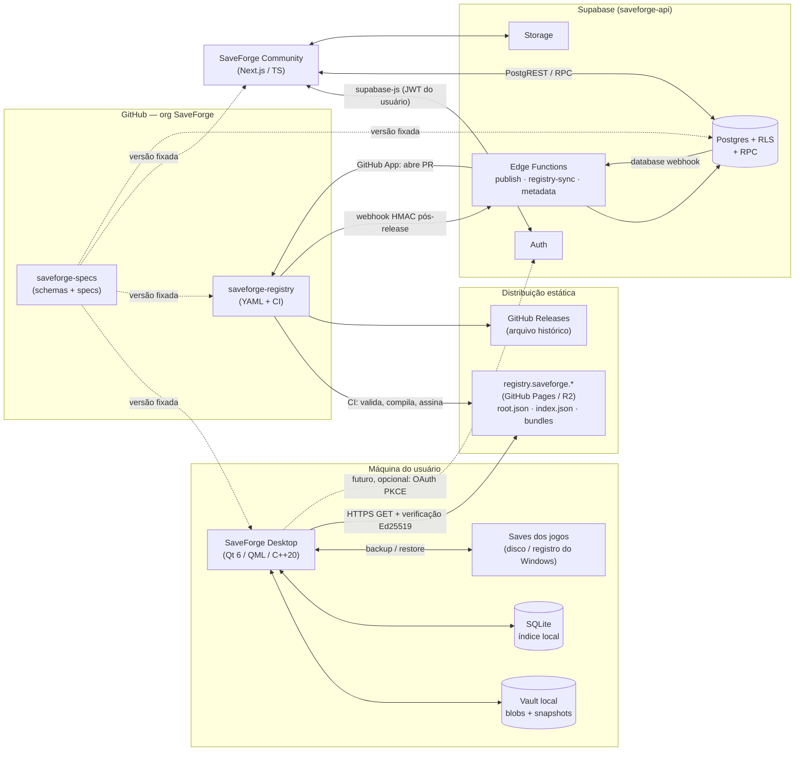
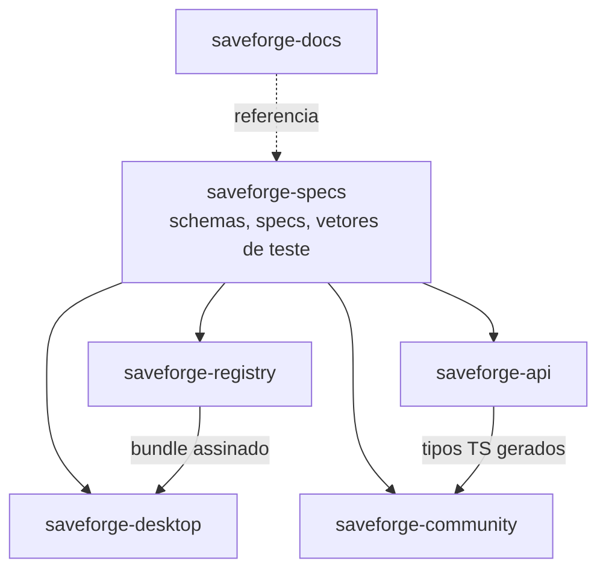
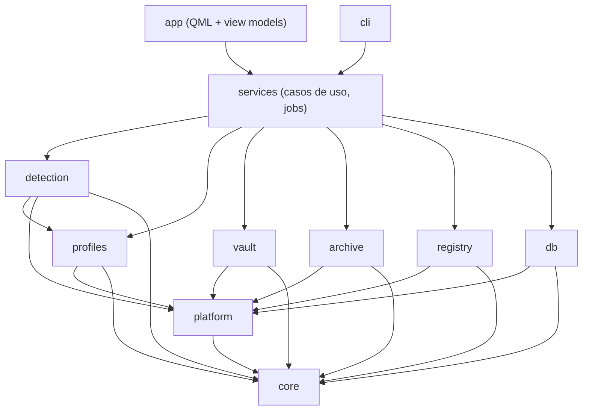
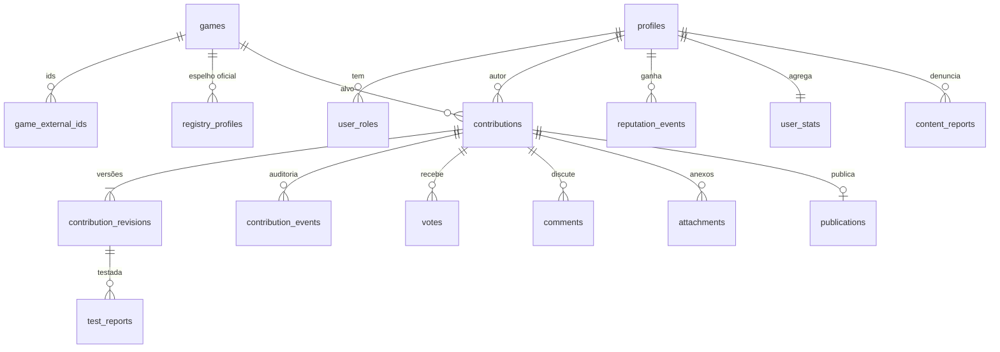
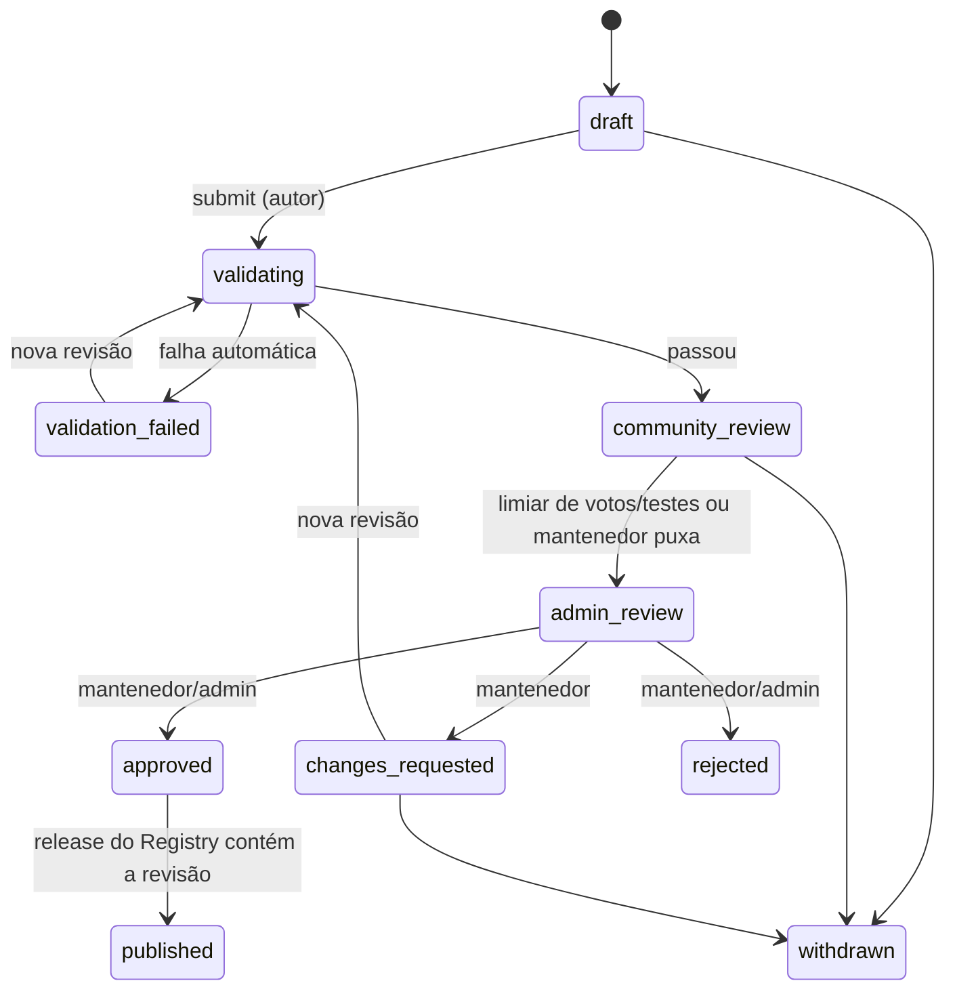
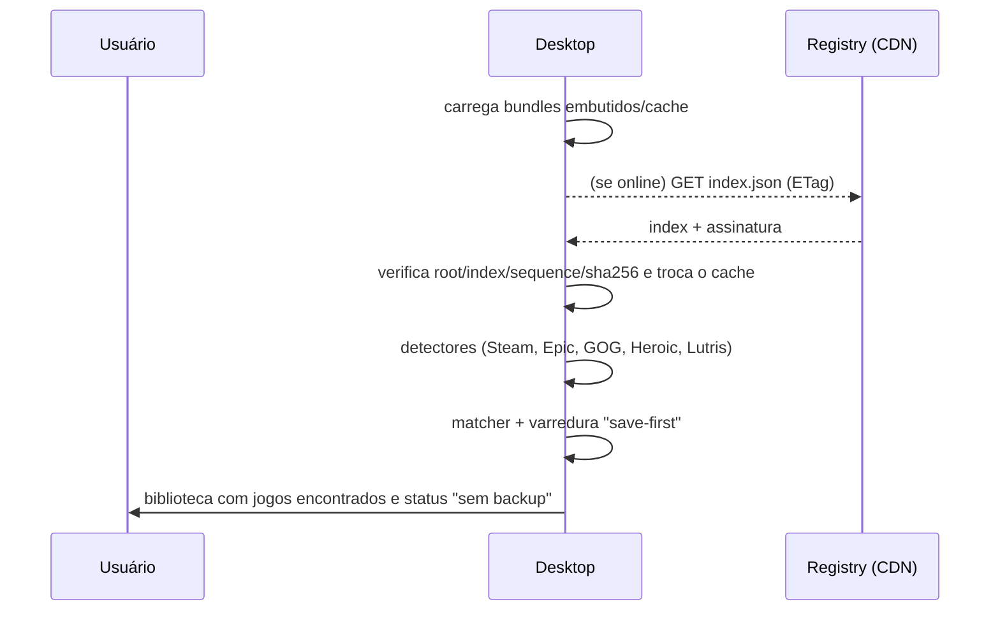
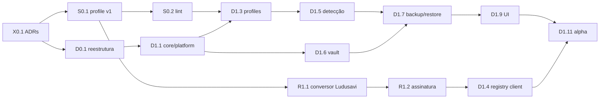

# SaveForge — Planejamento técnico do ecossistema

> **Status:** proposta para revisão (rascunho v0.1, 2026-11-09)
> **Escopo:** arquitetura, contratos, modelo de dados, segurança, testes, versionamento e roadmap.
> **Nada aqui está implementado.** As decisões estruturais estão registradas como ADRs em [`../adr/`](../adr/README.md) e só valem depois de aprovadas.

## Sumário

1. [Visão geral da arquitetura](#1-visão-geral-da-arquitetura)
2. [Diagrama de comunicação entre componentes](#2-diagrama-de-comunicação-entre-componentes)
3. [Decisões principais (resumo)](#3-decisões-principais-resumo)
4. [Estrutura dos seis repositórios](#4-estrutura-dos-seis-repositórios)
5. [SaveForge Desktop — arquitetura interna](#5-saveforge-desktop--arquitetura-interna)
6. [Especificação inicial dos perfis de jogos](#6-especificação-inicial-dos-perfis-de-jogos)
7. [Especificação inicial do formato `.gamesave`](#7-especificação-inicial-do-formato-gamesave)
8. [Registry — distribuição, atualização e assinatura](#8-registry--distribuição-atualização-e-assinatura)
9. [Backend Supabase — modelo de dados, autenticação e RLS](#9-backend-supabase--modelo-de-dados-autenticação-e-rls)
10. [SaveForge Community — arquitetura do website](#10-saveforge-community--arquitetura-do-website)
11. [Contratos entre componentes](#11-contratos-entre-componentes)
12. [Fluxos principais](#12-fluxos-principais)
13. [Fontes de dados externas](#13-fontes-de-dados-externas)
14. [Segurança e validação de contribuições](#14-segurança-e-validação-de-contribuições)
15. [Plano de testes](#15-plano-de-testes)
16. [Versionamento e releases](#16-versionamento-e-releases)
17. [Estratégia para nuvem (Fase 6)](#17-estratégia-para-nuvem-fase-6)
18. [Roadmap com dependências](#18-roadmap-com-dependências)
19. [Riscos técnicos e alternativas consideradas](#19-riscos-técnicos-e-alternativas-consideradas)
20. [Pontos que precisam da sua decisão](#20-pontos-que-precisam-da-sua-decisão)

---

## 1. Visão geral da arquitetura

O ecossistema se apoia em **três fontes da verdade**, uma para cada tipo de informação, sem sobreposição:

| Informação | Fonte da verdade | Quem consome |
|---|---|---|
| Saves e backups do usuário | **Máquina do usuário** (vault local do Desktop) | Desktop; futuramente nuvem escolhida pelo usuário |
| Perfis oficiais de jogos | **Repositório Git `saveforge-registry`** → bundle assinado | Desktop (download), Community (espelho de leitura) |
| Fluxo comunitário (usuários, contribuições, votos, comentários, reputação) | **Supabase** (`saveforge-api`) | Community; futuramente o Desktop, para login opcional |

Princípios que orientam o restante do documento:

1. **O Desktop é autônomo.** Ele funciona 100% offline com perfis em cache e um bundle embutido no instalador. O Supabase **nunca** está no caminho de backup ou restauração.
2. **O Registry é estático, assinado e independente.** São arquivos JSON versionados, servidos por CDN ou GitHub e verificados no cliente com Ed25519. Não existe API dinâmica para baixar perfis.
3. **Os perfis são dados, nunca código.** A comunidade descreve *onde* estão os saves e *qual mecanismo embutido* usar. Um mecanismo novo é código C++ revisado no repositório do Desktop.
4. **Dupla barreira de publicação.** Uma aprovação na Community gera um *Pull Request* no Registry. Ela não publica nada diretamente. Assim, comprometer o Supabase não basta para distribuir um perfil malicioso.
5. **Os contratos ficam em `saveforge-specs`.** Os JSON Schemas e as especificações são normativos, e os demais repositórios dependem de uma versão fixada (*pinned*) deles.
6. **Supabase nativo primeiro.** A ordem de preferência é PostgREST + RLS, depois funções Postgres (RPC) e, só quando necessário, Edge Functions. Não haverá API REST própria.

## 2. Diagrama de comunicação entre componentes



Nenhuma seta vai do Desktop para o Supabase nas Fases 1–4. A seta pontilhada é o login opcional da Fase 5.

## 3. Decisões principais (resumo)

| Tema | Decisão | ADR |
|---|---|---|
| UI do Desktop | **Qt Quick / QML** com Qt Quick Controls. O núcleo em C++ é independente de UI | [0001](../adr/0001-qt-quick-qml.md) |
| Linguagem e toolchain | **C++20**, **Qt 6.8+** (build oficial com a versão estável mais recente, hoje 6.12), CMake ≥ 3.24, vcpkg | [0002](../adr/0002-cpp20-qt6-toolchain.md) |
| Armazenamento de backups | **Vault com endereçamento por conteúdo** (SHA-256 + zstd). Snapshots imutáveis em JSON e SQLite apenas como índice reconstruível | [0003](../adr/0003-vault-content-addressed.md) |
| Formato `.gamesave` | **Contêiner ZIP** (deflate) com `mimetype` + `manifest.json` + `blobs/<sha256>` | [0004](../adr/0004-gamesave-zip.md) |
| Perfis de jogos | **YAML declarativo** no repositório, compilado para JSON. Mecanismos especiais são **tipos embutidos e parametrizáveis** no Desktop | [0005](../adr/0005-perfis-declarativos.md) |
| Distribuição do Registry | **Arquivos estáticos assinados** (Ed25519 via libsodium), modelo "TUF-lite" com `root.json`, número de sequência e expiração | [0006](../adr/0006-registry-estatico-assinado.md) |
| Backend | **Supabase direto + RLS + RPC**. Edge Functions apenas para segredos e integrações externas | [0007](../adr/0007-supabase-rls-rpc.md) |
| Ludusavi Manifest | Consumido como **canal "upstream" separado**, convertido no CI, com licença e atribuição preservadas | [0008](../adr/0008-ludusavi-upstream.md) |
| Login no Desktop | **OAuth PKCE + redirecionamento loopback** (RFC 8252), tokens no cofre do sistema operacional, sempre opcional | [0009](../adr/0009-login-desktop-pkce.md) |

---

## 4. Estrutura dos seis repositórios

### 4.1 Responsabilidades e dependências



Regras contra duplicação:
- Um schema é definido **somente** em `saveforge-specs`. Os outros repositórios consomem esse schema e geram tipos a partir dele, sem copiá-lo à mão.
- A lógica de "resolver um perfil em caminhos reais" existe **somente** no Desktop. O Community valida a estrutura e as regras de segurança dos caminhos, mas não os resolve.
- A documentação normativa (o que é obrigatório) fica em `saveforge-specs`. A documentação informativa (guias e tutoriais) fica em `saveforge-docs`.

### 4.2 `saveforge-desktop`

```
saveforge-desktop/
├── CMakeLists.txt
├── CMakePresets.json            # presets: windows-msvc, windows-mingw, linux-gcc, macos-clang, *-asan
├── vcpkg.json                   # dependências não-Qt (zstd, libsodium, minizip-ng, qtkeychain)
├── cmake/                       # módulos auxiliares (warnings, sanitizers, versioning)
├── external/specs/              # submódulo git de saveforge-specs (tag fixada)
├── src/
│   ├── core/                    # tipos de domínio, Result/Error, IDs, placeholders (QtCore apenas)
│   ├── platform/                # caminhos do SO, processos, registro do Windows, keychain
│   │   ├── windows/  linux/  macos/
│   ├── db/                      # SQLite: schema, migrations (PRAGMA user_version), repositórios
│   ├── profiles/                # carga/validação de perfis, precedência, resolver, mecanismos
│   │   └── mechanisms/          # standard, latest-n, store-user-scoped, registry-keys, ...
│   ├── detection/               # detectores de launchers + matcher + varredura "save-first"
│   │   ├── steam/  epic/  gog/  heroic/  lutris/  manual/
│   ├── vault/                   # armazenamento por conteúdo, snapshots, retenção, verificação
│   ├── archive/                 # leitura/escrita .gamesave
│   ├── registry/                # cliente: download, verificação de assinatura, cache, canais
│   ├── services/                # casos de uso: Scan, Backup, Restore, Export, Import, Scheduler
│   ├── app/                     # executável GUI: main.cpp, view models, qml/
│   │   └── qml/                 # Main.qml, pages/, components/, theme/
│   └── cli/                     # executável saveforge-cli (headless, scripts, testes e2e)
├── tests/
│   ├── unit/  integration/  e2e/
│   ├── fixtures/                # árvores falsas de Steam/Epic/GOG/Proton, saves de exemplo
│   └── fuzz/                    # alvos libFuzzer: VDF, perfis, .gamesave, index.json
├── packaging/
│   ├── windows/                 # instalador (WiX/Inno) + manifesto winget
│   ├── macos/                   # .app/.dmg, entitlements, notarização
│   └── linux/                   # AppImage, Flatpak (manifest), .desktop
├── resources/                   # ícones, bundle de perfis embutido (seed offline)
├── i18n/                        # saveforge_pt_BR.ts, saveforge_en.ts
└── docs/                        # notas internas do repositório (não normativas)
```

Observação sobre o estado atual: o projeto ainda se chama `SaveVault` (CMake, `.ts`, README) e usa Widgets com C++17. A tarefa D0.1 do roadmap substitui esse template. As pastas `build/` e `.qtcreator/` também precisam entrar no `.gitignore`.

### 4.3 `saveforge-registry`

```
saveforge-registry/
├── profiles/
│   └── h/hollow-knight/profile.yaml     # um perfil por diretório (permite anexos e README)
├── upstream/
│   └── ludusavi.lock.json               # commit fixado do Ludusavi Manifest + checksum
├── keys/
│   ├── root.pub                         # chaves públicas raiz (a privada fica OFFLINE)
│   └── root.json                        # lista de chaves de assinatura online, assinada pela raiz
├── tools/                               # TypeScript (Node LTS): validate, lint-paths, build, sign, convert-ludusavi
├── .github/
│   ├── workflows/validate.yml           # em todo PR: schema + lint de caminhos + diff legível
│   ├── workflows/release.yml            # em merge na main: build, assinatura, publicação
│   └── CODEOWNERS                       # mantenedores por pasta/letra
├── LICENSE-DATA                         # licença dos perfis nativos SaveForge
└── CONTRIBUTING.md                      # aponta para a Community como caminho principal
```

O repositório guarda **somente o código-fonte dos perfis**. Os artefatos compilados (`index.json`, bundles) são publicados pelo CI e não são versionados em Git.

### 4.4 `saveforge-specs`

```
saveforge-specs/
├── profile/
│   ├── SPEC.md                          # semântica normativa (RFC 2119)
│   ├── placeholders.md                  # <home>, <winAppData>, <xdgConfig>, <storeUserId>, ...
│   ├── mechanisms.md                    # catálogo de mecanismos embutidos e seus parâmetros
│   ├── schema/profile.v1.schema.json
│   └── examples/
├── gamesave/
│   ├── SPEC.md
│   ├── schema/manifest.v1.schema.json
│   └── test-vectors/                    # .gamesave válidos e inválidos para testes de conformidade
├── vault/SPEC.md                        # layout do vault local (necessário para a nuvem futura)
├── registry/
│   ├── SPEC.md                          # root.json, index.json, bundles, assinatura, canais
│   └── schema/{root,index,bundle}.v1.schema.json
├── integration/
│   ├── publication-pr.md                # formato do PR gerado pela Community no Registry
│   └── registry-sync-webhook.md         # payload HMAC do Registry para o Supabase
├── packages/js/                         # pacote npm @saveforge/specs (schemas + tipos TS gerados)
├── VERSIONING.md
└── CHANGELOG.md
```

### 4.5 `saveforge-api`

```
saveforge-api/
├── supabase/
│   ├── config.toml
│   ├── migrations/                      # <timestamp>_<nome>.sql (nunca editar migration aplicada)
│   ├── seed.sql                         # dados de desenvolvimento (usuários de teste, jogos)
│   ├── functions/
│   │   ├── _shared/                     # cliente admin, verificação HMAC, CORS, validação
│   │   ├── publish-contribution/        # abre PR no Registry via GitHub App
│   │   ├── registry-sync/               # recebe webhook de release, atualiza espelho
│   │   └── game-metadata/               # proxy com cache para IGDB/SteamGridDB (segredos)
│   └── tests/                           # pgTAP: *.test.sql (RLS, RPC, triggers)
├── types/                               # database.types.ts gerado (publicado como @saveforge/db-types)
└── docs/                                # operações: deploy, rotação de segredos, papéis
```

### 4.6 `saveforge-community`

```
saveforge-community/
├── src/
│   ├── app/
│   │   ├── (public)/  games/[slug]/  contributions/[id]/  u/[username]/
│   │   ├── (auth)/    login/  signup/  reset-password/  auth/callback/
│   │   ├── (account)/ me/  me/contributions/
│   │   └── admin/     queue/  contributions/[id]/review/  users/  reports/
│   ├── features/                        # contributions/, votes/, comments/, games/, reputation/
│   │   └── <feature>/{components,actions.ts,queries.ts,schemas.ts}
│   ├── lib/supabase/{server.ts,browser.ts,middleware.ts}
│   ├── components/ui/                   # shadcn/ui
│   └── middleware.ts                    # renovação de sessão (@supabase/ssr)
├── tests/{unit,e2e}/
└── package.json                         # depende de @saveforge/specs e @saveforge/db-types
```

### 4.7 `saveforge-docs`

```
saveforge-docs/
├── adr/                                 # decisões transversais (este planejamento)
├── planejamento/                        # este documento
├── site/                                # Starlight (Astro): guias de usuário e contribuidor
│   └── src/content/docs/{pt-br,en}/
└── README.md
```

As ADRs **locais** de cada repositório, como "por que minizip-ng", ficam em `docs/adr/` do próprio repositório. As ADRs que afetam mais de um repositório ficam aqui.

---

## 5. SaveForge Desktop — arquitetura interna

### 5.1 Camadas e regra de dependência



- Cada pasta de `src/` é uma **biblioteca CMake estática** (`saveforge::core`, `saveforge::vault`, ...). Os executáveis `app` e `cli` apenas montam essas bibliotecas.
- `core` depende apenas de **QtCore**. Nenhuma biblioteca abaixo de `app` depende de QtGui ou QtQuick. Isso garante que a CLI e os testes rodem sem display.
- A UI **nunca** acessa o disco diretamente. Ela chama `services`, que executam *jobs* canceláveis em `QThreadPool` e reportam progresso por sinais.
- Os erros usam um tipo `Result<T, Error>` próprio (no C++20 ainda não existe `std::expected`). Exceções não atravessam fronteiras de módulo.

### 5.2 Dependências

| Dependência | Uso | Licença |
|---|---|---|
| Qt 6 (Core, Gui, Quick, QuickControls2, Sql, Network, Concurrent, Test) | base | LGPLv3 (link dinâmico) |
| SQLite (via driver QSQLITE do Qt) | índice local | domínio público |
| zstd | compressão dos blobs do vault | BSD |
| libsodium | verificação Ed25519 do Registry; criptografia da nuvem no futuro | ISC |
| minizip-ng | leitura e escrita de ZIP (`.gamesave`) | zlib |
| QtKeychain (Fase 5) | tokens no cofre do SO | BSD |

O hash é SHA-256 via `QCryptographicHash`, sem dependência extra. Os saves costumam ser pequenos e o SHA-256 é universal. O parser de VDF da Steam (texto e binário, para `shortcuts.vdf`) será escrito no próprio projeto, porque é pequeno e precisa passar por fuzzing.

### 5.3 Estratégia de detecção de jogos

Um pipeline com três estratégias complementares:

1. **Detectores de launcher** produzem `InstallCandidate {store, storeId, installDir, displayName, executables[]}`:
   - **Steam:** caminho via registro (Windows) ou `~/.steam/steam` / `~/.local/share/Steam` / `~/Library/Application Support/Steam`, depois `libraryfolders.vdf`, `appmanifest_*.acf`, `userdata/<id>` (para `<storeUserId>`) e `shortcuts.vdf` (jogos não-Steam). No Linux, detecta prefixos **Proton** em `compatdata/<appid>/pfx`.
   - **Epic:** manifests `*.item` em `ProgramData/Epic/EpicGamesLauncher/Data/Manifests` (Windows e macOS). No Linux, via Heroic/Legendary.
   - **GOG:** registro `HKLM\Software\WOW6432Node\GOG.com\Games` e o banco do Galaxy. No Linux, via Heroic.
   - **Heroic** (`installed.json`, prefixos Wine) e **Lutris** (`pga.db`) no Linux.
   - Fases posteriores: itch.io, EA app, Ubisoft Connect, Battle.net, Amazon. **Xbox/Microsoft Store fica fora da v1**, porque os saves ficam em contêineres `wgs` protegidos (ver Riscos).
2. **Matcher:** cruza os candidatos com o índice de perfis por ordem de confiança: ID da loja (exato) > nome do executável > nome do diretório (normalizado). O resultado guarda a confiança e a origem da correspondência.
3. **Varredura "save-first":** para todo perfil sem instalação detectada, verifica se algum caminho de save resolvido existe. Assim aparecem jogos instalados manualmente, jogos portáteis e jogos desinstalados com saves remanescentes. É o mesmo princípio do Ludusavi, e é ele que cumpre o requisito de "não depender dos launchers".
4. **Adição manual:** o usuário escolhe um executável ou diretório, vincula a um perfil existente ou cria um **perfil local** (mesmo schema, armazenado no SQLite, com precedência máxima).

**Prefixos Wine/Proton:** o resolver de caminhos aplica perfis `os: windows` dentro do prefixo detectado. Por exemplo, `<winAppData>` passa a ser `<prefix>/drive_c/users/steamuser/AppData/Roaming`. Isso é automático e não exige nada no perfil.

### 5.4 Banco SQLite local

Fica em `QStandardPaths::AppDataLocation/saveforge.db`, em modo WAL, com migrations sequenciais (`PRAGMA user_version`). **O banco é um índice, não a fonte da verdade:** os snapshots também ficam em JSON dentro do vault, e o comando "Reconstruir índice" recria o banco a partir deles.

| Tabela | Conteúdo |
|---|---|
| `games` | jogo conhecido localmente (id do perfil ou `local:<uuid>`, nome, capa em cache) |
| `installs` | instalações detectadas (loja, storeId, diretório, último visto, confiança) |
| `local_profiles` | perfis criados pelo usuário (JSON, mesmo schema) |
| `profile_pins` | perfil fixado em uma versão específica por jogo (permite reverter um perfil problemático) |
| `snapshots` | id (UUIDv7), jogo, data, tipo (`manual`, `auto`, `pre-restore`, `import`), rótulo, tamanho, versão do perfil usada |
| `snapshot_files` | snapshot, caminho template, sha256, tamanho, mtime |
| `blobs` | sha256, tamanho comprimido, contagem de referências, última verificação |
| `jobs` / `operation_log` | histórico de operações importantes (backup, restore, delete, import) com resultado |
| `settings` | preferências globais (diretório do vault, retenção, agendamentos, canal do Registry, política padrão de cloud) |
| `game_settings` | preferências por jogo (retenção, backup automático, `cloud_policy`) |
| `registry_state` | canal, último `sequence` aceito, ETag, data da última verificação |

### 5.5 Vault e backup incremental

```
<vault>/                                  # padrão: AppData/SaveForge/vault (configurável)
├── vault.json                            # id, versão do formato, data de criação
├── blobs/sha256/ab/abcdef0123…zst        # conteúdo comprimido (zstd), nomeado pelo hash do conteúdo original
├── snapshots/<game-id>/<snapshot-id>.json
└── locks/                                # lock de processo (um único escritor)
```

- **O incremental vem de graça:** um snapshot é uma lista `caminho → sha256`. Arquivos que não mudaram reaproveitam o mesmo blob. Nada é duplicado entre snapshots nem entre jogos.
- **Escrita segura:** o blob é gravado em `tmp`, recebe `fsync` e é renomeado de forma atômica. O snapshot JSON é gravado por último. Se o processo falhar no meio, sobram apenas blobs órfãos, que a coleta de lixo remove.
- **Retenção:** é configurada por jogo (ex.: últimos 20 + 1 por dia nos últimos 30 dias + snapshots com rótulo manual para sempre). Uma coleta de lixo por *mark-and-sweep* remove os blobs sem referência.
- **Verificação:** um job periódico relê os blobs e confere o SHA-256.

### 5.6 Backup com o jogo aberto e proteção contra sobrescrita

- **Detecção de processo:** cada perfil pode declarar `processNames`. Também é considerado processo do jogo qualquer executável rodando dentro do diretório de instalação.
- **Backup com o jogo aberto:** o backup é permitido, mas cada arquivo é lido, hasheado e conferido de novo (tamanho e mtime antes e depois). Se o arquivo mudou durante a cópia, a leitura é repetida (até 3 vezes). Se continuar instável, o snapshot é marcado como `inconsistent` e o usuário recebe um aviso. Perfis com `requireGameClosed: true` bloqueiam o backup.
- **Restauração com o jogo aberto: sempre bloqueada.**
- **Antes de qualquer restauração**, um snapshot automático `pre-restore` do estado atual é criado, para que a restauração possa ser desfeita.
- **Restauração atômica:** os arquivos são escritos em um diretório de *staging* no mesmo volume, verificados pelo hash e só então trocados por rename. Se houver falha, nada é alterado.
- **Conflitos:** quando o save atual é mais novo que o snapshot escolhido ou contém arquivos ausentes nele, a UI mostra um diff (arquivos adicionados, removidos e alterados) e pede confirmação.
- **Steam Cloud e outros clouds de launcher:** quem decide é o usuário (ver §5.6.1).

#### 5.6.1 Prioridade entre o SaveForge e o cloud do launcher

Quando um jogo tem cloud ativo na loja (Steam Cloud, GOG Galaxy, Epic, ...), restaurar um save pelo SaveForge pode entrar em conflito com o cloud: o launcher pode sobrescrever o save restaurado, ou mostrar um diálogo de conflito. O SaveForge **não decide sozinho** e **não altera configurações do launcher**. O usuário escolhe uma política, que pode ser global ou por jogo:

| Política | Comportamento na restauração | Backups |
|---|---|---|
| **Perguntar sempre** (padrão) | Antes de restaurar, mostra o conflito e oferece as duas opções abaixo, com "lembrar para este jogo" | normais |
| **Priorizar o cloud do launcher** | O SaveForge não restaura sobre um jogo com cloud ativo. O botão "Restaurar" vira "Exportar para pasta…", para restauração manual consciente | normais. O SaveForge continua como cópia de segurança extra |
| **Priorizar o SaveForge** | Restaura e mostra um guia específico da loja. Na Steam, por exemplo: escolher "manter arquivos locais" no diálogo de conflito, ou desativar o Steam Cloud do jogo nas propriedades | normais |

Detalhes:
- **Detecção do cloud:** o perfil declara se o jogo usa cloud (`backup.cloudSync`). Quando for possível, o app confirma localmente. Na Steam, por exemplo, pela existência de `userdata/<id>/<appid>/remotecache.vdf`. O formato exato dos arquivos de configuração da Steam será investigado na implementação. Se não for possível detectar, vale o que o perfil diz.
- **Restaurar com o launcher aberto:** com a política "Priorizar o SaveForge", o app recomenda fechar o launcher antes de restaurar, porque o launcher pode sincronizar no meio da operação.
- **Desfazer:** o snapshot `pre-restore` continua sendo criado em todos os casos.
- **Onde fica a escolha:** em `game_settings.cloud_policy` (`ask` | `prefer_launcher` | `prefer_saveforge`), com um valor global em `settings`.

### 5.7 Backups automáticos

Há três gatilhos, todos dentro do aplicativo, sem serviço de sistema e **sem exigir privilégio de administrador**:
1. **Saída do jogo:** um monitor de processos (polling leve a cada ~10 s) dispara o backup quando o processo do jogo termina.
2. **Agendamento:** um intervalo definido por jogo ou global.
3. **Mudança de arquivo:** `QFileSystemWatcher` com *debounce*, usado só como sinal e confirmado por hash, porque o watcher tem limites por SO.

O app pode rodar minimizado na bandeja e iniciar com o sistema (opcional, desligado por padrão).

### 5.8 UI (QML)

As telas da Fase 1 são: **Biblioteca** (grade de capas com filtros por loja e status de backup), **Detalhe do jogo** (caminhos resolvidos, histórico de snapshots, restaurar e comparar), **Atividade** (jobs e log), **Configurações** (vault, retenção, canal do Registry, idioma) e **Adicionar jogo** (manual). Os modelos C++ derivam de `QAbstractListModel` e são registrados com `QML_ELEMENT` e `qt_add_qml_module`. A tradução usa `qsTr`, com pt_BR e en desde o início.

---

## 6. Especificação inicial dos perfis de jogos

### 6.1 Formato

- **Autoria** em YAML no repositório do Registry, porque é mais legível em revisão de PR.
- **Distribuição** em JSON, porque o Desktop usa `QJsonDocument` e não precisa de parser YAML.
- **Validação** por JSON Schema (`profile.v1.schema.json`), seguida de um lint de segurança de caminhos (§14.2).

### 6.2 Exemplo (`profile.v1`)

```yaml
schemaVersion: 1
id: hollow-knight                      # slug estável, nunca reutilizado
name: Hollow Knight
revision: 3                            # incrementa a cada alteração publicada
identifiers:
  steam: [367520]
  gog: [1308320804]
  epic: []
  executables: ["hollow_knight.exe", "hollow_knight.x86_64", "Hollow Knight.app"]
  installDirNames: ["Hollow Knight"]
saves:
  - id: progress
    tags: [save]
    when: { os: windows }
    paths: ["<winLocalAppDataLow>/Team Cherry/Hollow Knight/user*.dat"]
  - id: progress
    tags: [save]
    when: { os: linux }
    paths: ["<xdgConfig>/unity3d/Team Cherry/Hollow Knight/user*.dat"]
  - id: settings
    tags: [config]
    when: { os: windows }
    paths: ["<winLocalAppDataLow>/Team Cherry/Hollow Knight/shared.dat"]
registry:                              # somente Windows
  - id: prefs
    tags: [config]
    keys: ["HKCU/Software/Team Cherry/Hollow Knight"]
exclude: ["**/*.log", "**/Crashes/**"]
backup:
  requireGameClosed: false
  processNames: ["hollow_knight.exe", "hollow_knight.x86_64"]
  cloudSync: { steam: true }           # gera o aviso de conflito com o cloud do launcher
mechanism:
  type: standard                       # ver catálogo §6.4
compatibility:
  minAppVersion: "0.1.0"
  gameVersions: ">=1.5"                # informativo
provenance:
  basedOn: { ludusavi: "Hollow Knight" }
  contributors: ["community:<user-uuid>"]
```

### 6.3 Placeholders

Os caminhos **devem** começar por um placeholder. O conjunto inicial:

| Placeholder | Windows | Linux | macOS |
|---|---|---|---|
| `<home>` | `%USERPROFILE%` | `$HOME` | `$HOME` |
| `<winAppData>` / `<winLocalAppData>` / `<winLocalAppDataLow>` | `%APPDATA%` / `%LOCALAPPDATA%` / `…\LocalLow` | dentro do prefixo Wine/Proton | — |
| `<winDocuments>` / `<winSavedGames>` / `<winPublic>` / `<winProgramData>` | pastas conhecidas | dentro do prefixo | — |
| `<xdgData>` / `<xdgConfig>` | — | `$XDG_DATA_HOME` / `$XDG_CONFIG_HOME` | — |
| `<macAppSupport>` / `<macPreferences>` / `<macContainers>` | — | — | `~/Library/...` |
| `<base>` | diretório de instalação detectado | idem | idem |
| `<storeUserId>` | ID do usuário na loja (ex.: SteamID3), expandido para cada conta | idem | idem |
| `<osUserName>` | nome do usuário do SO | idem | idem |

Os nomes ficam alinhados aos do Ludusavi sempre que existir equivalente, o que facilita a conversão.

### 6.4 Mecanismos embutidos (catálogo v1)

Um "novo mecanismo" proposto pela comunidade é uma **solicitação de funcionalidade**, implementada em C++ no Desktop e revisada como qualquer outro código. Depois disso, ela vira um `type` disponível para os perfis.

| `type` | Uso | Parâmetros |
|---|---|---|
| `standard` | copia os arquivos que casam com os globs | — |
| `latest-n` | jogos que criam um diretório ou arquivo por save; guarda apenas os N mais recentes | `n`, `sortBy: mtime\|name` |
| `store-user-scoped` | saves por conta da loja; na restauração em outra conta, pede o mapeamento | `store` |
| `registry-keys` | exporta e importa chaves do registro do Windows (formato JSON próprio, nunca `.reg` executável) | — |
| `consistent-copy` | arquivos que precisam ser copiados juntos (ex.: `*.db` + `*.db-wal`) | `groups` |
| `size-guard` | jogos com saves grandes; exige confirmação acima do limite | `maxBytes` |

Um perfil que referencia um `type` desconhecido pelo app instalado é **ignorado com aviso**, e o app sugere atualizar. O perfil não é interpretado parcialmente.

### 6.5 Precedência

`perfil local do usuário` > `official` > `upstream-ludusavi`. Quando um perfil oficial e um perfil upstream compartilham o mesmo jogo (por `provenance.basedOn` ou pelos IDs de loja), o oficial **substitui o upstream por inteiro**. Não há mesclagem, o que mantém o comportamento previsível e auditável.

---

## 7. Especificação inicial do formato `.gamesave`

### 7.1 Contêiner

O arquivo é um **ZIP** com deflate, escolhido para inspeção fácil e máxima compatibilidade com outras ferramentas:

```
arquivo.gamesave
├── mimetype                 # 1ª entrada, STORED, conteúdo: application/vnd.saveforge.gamesave+zip
├── manifest.json            # metadados (schema manifest.v1)
├── manifest.json.sha256     # hash do manifest (detecção de corrupção)
└── blobs/
    └── <sha256>             # conteúdo original de cada arquivo, deduplicado
```

O mesmo arquivo pode aparecer em vários snapshots e jogos e é armazenado uma única vez. O deflate do ZIP faz a compressão: o zstd interno do vault não é usado no export, para não exigir leitores com suporte a zstd.

### 7.2 `manifest.json` (exemplo)

```json
{
  "format": "saveforge.gamesave",
  "formatVersion": 1,
  "exportId": "0193f1c2-7a4e-7d2b-9c11-5e3f0a8b9d10",
  "createdAt": "2026-11-09T14:03:22Z",
  "createdBy": { "app": "SaveForge Desktop", "version": "0.2.0" },
  "mode": "full",
  "baseExportId": null,
  "source": { "os": "windows", "placeholders": { "<home>": "C:/Users/dario" } },
  "games": [
    {
      "gameId": "hollow-knight",
      "name": "Hollow Knight",
      "profile": { "channel": "official", "id": "hollow-knight", "revision": 3 },
      "snapshots": [
        {
          "snapshotId": "0193f1c0-…",
          "createdAt": "2026-11-08T22:10:00Z",
          "kind": "manual",
          "label": "Antes do chefe final",
          "files": [
            { "path": "<winLocalAppDataLow>/Team Cherry/Hollow Knight/user1.dat",
              "sha256": "9f2c…", "size": 482133, "mtime": "2026-11-08T22:09:51Z" }
          ],
          "registry": [
            { "key": "HKCU/Software/Team Cherry/Hollow Knight",
              "values": [{ "name": "ResolutionX", "type": "REG_DWORD", "data": 1920 }] }
          ]
        }
      ]
    }
  ]
}
```

### 7.3 Regras normativas

- Os caminhos ficam **sempre em forma de template** (com placeholder). Na importação, são resolvidos com os valores da máquina de destino. `source.placeholders` é informativo e opcional, para diagnóstico. Como ele contém o nome do usuário, o export oferece a opção de omiti-lo.
- **Na importação**, o app verifica o CRC do ZIP, o SHA-256 de cada blob (o nome deve ser igual ao hash do conteúdo), `manifest.json.sha256` e o schema. Entradas com `..`, caminhos absolutos ou symlinks são rejeitadas (proteção contra *zip-slip*). Há limites de tamanho total e de razão de compressão (proteção contra *zip bomb*).
- **Importar não restaura.** O conteúdo entra no vault como snapshots `import`, e a restauração continua sendo um passo explícito, com as proteções do §5.6.
- **Modo incremental** (Fase 2, tarefa D2.5): `mode: "incremental"` + `baseExportId`, com apenas os blobs ausentes na base. A importação exige que a base já tenha sido importada antes.
- **Compatibilidade:** um leitor de `formatVersion: N` rejeita arquivos com versão maior que N e uma mensagem clara. Campos desconhecidos são ignorados, o que permite evolução aditiva.

---

## 8. Registry — distribuição, atualização e assinatura

### 8.1 Artefatos publicados

```
https://registry.<domínio>/v1/
├── root.json            + root.json.sig       # chaves de assinatura válidas; assinado pela(s) chave(s) raiz
├── channels/official/
│   ├── index.json       + index.json.sig      # sequence, expires, lista de bundles com sha256/tamanho
│   └── bundles/official-000042.json.zst
└── channels/upstream-ludusavi/
    ├── index.json       + index.json.sig
    └── bundles/upstream-ludusavi-000017.json.zst
```

`index.json`:
```json
{
  "channel": "official",
  "schemaVersion": 1,
  "sequence": 42,
  "publishedAt": "2026-11-09T12:00:00Z",
  "expires": "2027-02-07T12:00:00Z",
  "minAppVersion": "0.1.0",
  "bundle": { "url": "bundles/official-000042.json.zst", "sha256": "…", "size": 812345, "profiles": 1840 },
  "source": { "repo": "SaveForge/saveforge-registry", "commit": "a1b2c3d" }
}
```

### 8.2 Assinatura e verificação ("TUF-lite")

- **Chave raiz (offline):** um par Ed25519 guardado fora de qualquer CI, com backup em dois locais físicos. Ela assina somente o `root.json`, que lista as chaves *online* válidas e tem data de expiração longa. A chave pública raiz é **embutida no binário do Desktop**. Recomenda-se ter duas chaves raiz para permitir rotação.
- **Chave online:** fica como segredo no GitHub Actions, em um *environment* `registry-release` protegido por revisores obrigatórios. Ela assina os `index.json`.
- **O cliente verifica:** assinatura do `root.json` com a raiz embutida → assinatura do `index.json` com uma chave online listada → `sequence` ≥ último aceito (**anti-rollback**) → `expires` (**anti-congelamento**) → SHA-256 do bundle → schema de cada perfil. Se qualquer etapa falhar, o cache atual continua em uso e o app avisa o usuário. O app nunca fica sem perfis.
- **Index expirado:** o app continua funcionando com o cache e mostra um aviso. Expiração não pode quebrar o uso offline.

### 8.3 Atualização no Desktop

- Verificação na inicialização e a cada 24 h, com `If-None-Match` (ETag). Uma lista de *mirrors* (GitHub Pages, R2 e GitHub Releases) é tentada em ordem.
- O app guarda os **últimos 3 bundles** por canal, o que permite reverter localmente. O usuário pode **fixar** a versão do perfil de um jogo (`profile_pins`).
- O **instalador embute um bundle** de cada canal, para que o primeiro uso funcione offline.

### 8.4 Reverter uma atualização problemática

1. **Global:** o perfil é revertido no Git (PR de *revert*) e o CI publica um `sequence` **maior** com o conteúdo antigo. A sequência nunca diminui.
2. **Emergência:** um campo `revoked: [{id, revision}]` no `index.json` faz o Desktop voltar à revisão anterior do perfil, guardada em cache.
3. **Local:** o usuário fixa a revisão anterior de um perfil.

### 8.5 Canais

- `official`: padrão e o único ativo na v1.
- `upstream-ludusavi`: o Ludusavi Manifest convertido (§13.1), ativo por padrão porque garante cobertura desde o primeiro dia. Pode ser desligado.
- `community-experimental` (Fase 5): contribuições ainda não aprovadas, com chave própria, *opt-in* e um aviso visível na UI.

---

## 9. Backend Supabase — modelo de dados, autenticação e RLS

### 9.1 Organização do schema

| Schema | Exposto pela API? | Conteúdo |
|---|---|---|
| `public` | sim (com RLS em **todas** as tabelas) | tabelas acessadas pelo cliente, views públicas, RPCs |
| `private` | **não** | funções auxiliares de autorização, tabelas internas (fila de publicação, segredos de webhook) |
| `auth`, `storage` | gerenciados pelo Supabase | — |

Todas as funções `security definer` usam `set search_path = ''` e nomes totalmente qualificados.

### 9.2 Modelo de dados inicial



| Tabela | Colunas principais | Observações |
|---|---|---|
| `profiles` | `id` (= `auth.users.id`), `username` (único, citext), `display_name`, `avatar_path`, `bio`, `created_at` | criada por trigger em `auth.users` |
| `user_roles` | `user_id`, `role` (`admin`\|`maintainer`\|`moderator`), `game_id` (escopo opcional), `granted_by`, `granted_at`, `revoked_at` | escrita somente por admin via RPC |
| `games` | `id`, `slug`, `name`, `cover_url`, `created_at` | catálogo; alimentado pelo espelho do Registry e por novos perfis aprovados |
| `game_external_ids` | `game_id`, `source` (`steam`\|`gog`\|`epic`\|`igdb`\|`steamgriddb`), `external_id` | único (`source`, `external_id`) |
| `registry_profiles` | `game_id`, `profile_id`, `revision`, `payload` jsonb, `registry_sequence` | **somente leitura** para clientes; escrito pelo `registry-sync` |
| `contributions` | `id`, `author_id`, `game_id` (nulo se o jogo for novo), `kind` (`new_profile`\|`correction`\|`new_mechanism`), `status`, `title`, `description`, `base_profile_revision`, `current_revision_id`, `score`, `created_at`, `updated_at` | `status` só muda via RPC |
| `contribution_revisions` | `id`, `contribution_id`, `rev_no`, `payload` jsonb (perfil proposto), `validation` jsonb, `created_by`, `created_at` | **imutável** (sem UPDATE/DELETE): forma o histórico de alterações |
| `contribution_events` | `contribution_id`, `from_status`, `to_status`, `actor_id`, `reason`, `at` | trilha de auditoria; somente trigger e RPC inserem |
| `votes` | PK (`contribution_id`, `user_id`), `value` (−1\|1), `created_at` | a PK impede voto duplicado |
| `test_reports` | `id`, `revision_id`, `user_id`, `os`, `store`, `result` (`works`\|`partial`\|`fails`), `notes`, `app_version` | único (`revision_id`, `user_id`) |
| `comments` | `id`, `contribution_id`, `author_id`, `parent_id`, `body`, `created_at`, `edited_at`, `deleted_at` | exclusão lógica |
| `attachments` | `id`, `contribution_id`, `owner_id`, `storage_path`, `mime`, `size` | metadados; o arquivo fica no Storage |
| `reputation_events` | `id`, `user_id`, `delta`, `reason`, `source_type`, `source_id`, `at` | *append-only*, gerado por trigger e RPC |
| `user_stats` | `user_id`, `reputation`, `contributions_total/approved/rejected`, `tests_given`, `tests_received` | mantida por trigger; leitura pública |
| `content_reports` | `id`, `reporter_id`, `target_type`, `target_id`, `reason`, `status` | denúncias para moderação |
| `publications` | `contribution_id`, `revision_id`, `status` (`queued`\|`pr_open`\|`merged`\|`released`\|`failed`), `pr_url`, `registry_sequence` | atualizada por Edge Functions |

**Máquina de estados de `contributions.status`:**



Os votos **apenas promovem** uma contribuição para `admin_review`, e nunca a aprovam sozinhos, conforme o requisito do produto.

### 9.3 Autenticação

- **Supabase Auth:** e-mail e senha com confirmação obrigatória, recuperação de senha e SMTP próprio (ex.: Resend), já que o SMTP padrão do Supabase tem limites baixos. CAPTCHA (Turnstile ou hCaptcha) no cadastro, login e recuperação. Login social com GitHub e Google em fase posterior.
- **Website:** usa `@supabase/ssr` com sessão em cookies. Os Server Components e as Server Actions usam **o JWT do usuário**, então a RLS sempre se aplica.
- **Chaves:** somente a chave *publishable* (anon) no frontend. A chave *secret* (service role) existe apenas nas Edge Functions.
- **Papéis:** a fonte é `user_roles`, consultada pela função `private.has_role()`. Um *Custom Access Token Hook* que copia os papéis para o JWT pode ser adicionado como otimização, mas a autorização final continua sendo checada no banco.

### 9.4 Autorização: padrões de RLS

```sql
-- auxiliar (schema private, não exposto)
create function private.has_role(p_role public.app_role, p_game uuid default null)
returns boolean language sql stable security definer set search_path = '' as $$
  select exists (
    select 1 from public.user_roles r
    where r.user_id = (select auth.uid())
      and r.revoked_at is null
      and (r.role = p_role or r.role = 'admin')
      and (r.game_id is null or r.game_id = p_game)
  );
$$;

alter table public.contributions enable row level security;

-- leitura: o público vê o que já foi submetido; o autor vê seus rascunhos; a moderação vê tudo
create policy contributions_select on public.contributions for select using (
  status <> 'draft'
  or author_id = (select auth.uid())
  or private.has_role('moderator')
);

-- criação: somente como rascunho e com o próprio autor
create policy contributions_insert on public.contributions for insert to authenticated
  with check (author_id = (select auth.uid()) and status = 'draft');

-- edição direta: só campos textuais do próprio rascunho; status nunca
revoke update on public.contributions from authenticated;
grant update (title, description) on public.contributions to authenticated;
create policy contributions_update_own_draft on public.contributions for update to authenticated
  using (author_id = (select auth.uid()) and status in ('draft', 'changes_requested'))
  with check (author_id = (select auth.uid()));
```

**As transições de estado e as operações sensíveis passam exclusivamente por RPC** (`security definer`, com validação interna):

| RPC | Quem | Validações |
|---|---|---|
| `submit_contribution(id)` | autor | estado permitido; revisão atual existe |
| `add_revision(id, payload)` | autor | estado `draft`/`changes_requested`/`validation_failed`; payload validado com **`pg_jsonschema`** e lint de caminhos em SQL |
| `cast_vote(id, value)` | autenticado | não pode ser o autor; conta com e-mail confirmado e idade mínima (ex.: 7 dias); estado em revisão; limite de taxa |
| `submit_test_report(revision_id, …)` | autenticado | um relatório por revisão e usuário; não pode ser o autor |
| `review_contribution(id, decision, reason)` | `maintainer` (com escopo) / `admin` | estado `admin_review`; **não pode revisar a própria contribuição**; registra o evento e enfileira a publicação |
| `grant_role` / `revoke_role` | `admin` | auditado |
| `moderate_comment(id, action)` | `moderator` | auditado |

Os contadores (`score`, `user_stats`) são recalculados por trigger a partir de `votes` e `test_reports`, e o cliente nunca os escreve. A `score` pode ponderar votos pela reputação do votante, com um teto por votante.

**Storage:**
- `avatars` (público, `image/png|jpeg|webp`, ≤ 1 MB). Caminho `<user_id>/…`, e a policy permite escrita apenas quando `(storage.foldername(name))[1] = auth.uid()::text`.
- `evidence` (leitura pública somente para contribuições não-rascunho, `image/*` + `text/plain`, ≤ 5 MB), com a mesma regra de pasta. Tipos MIME e tamanho são configurados no bucket. Arquivos executáveis nunca são aceitos.

### 9.5 Quando usar Edge Functions

| Função | Por que não é RPC/PostgREST |
|---|---|
| `publish-contribution` | precisa de um segredo do GitHub App e chama uma API externa. Disparada por *database webhook* ao inserir em `publications` |
| `registry-sync` | recebe um webhook externo (assinado por HMAC) do CI do Registry e escreve com a service role em `registry_profiles` e `publications` |
| `game-metadata` | proxy com cache para IGDB e SteamGridDB, cujas credenciais não podem ir para o cliente |
| `notify` (futuro) | envio de e-mails e notificações |

A validação de contribuições fica **no Postgres** (`pg_jsonschema` + funções SQL), e não em uma Edge Function. Assim a regra é aplicada mesmo se o cliente chamar a API diretamente.

### 9.6 Migrations

```
supabase/migrations/
  20261201000000_extensions_schemas.sql      -- citext, pg_jsonschema, schema private, enums
  20261201000100_profiles.sql                -- profiles + trigger on auth.users + RLS
  20261201000200_roles.sql                   -- user_roles, private.has_role, RPC grant/revoke + RLS
  20261201000300_games.sql                   -- games, game_external_ids, registry_profiles + RLS
  20261201000400_contributions.sql           -- contributions, revisions, events, máquina de estados + RLS
  20261201000500_engagement.sql              -- votes, test_reports, comments, reports + RLS
  20261201000600_reputation.sql              -- reputation_events, user_stats, triggers
  20261201000700_storage.sql                 -- buckets + policies
  20261201000800_publication.sql             -- publications, webhooks
```

Regras:
- Toda tabela nasce **com RLS habilitada e suas policies na mesma migration**.
- Uma migration aplicada nunca é editada.
- O CI roda `supabase db reset` + pgTAP em todo PR.
- Um teste pgTAP falha se existir tabela em `public` sem RLS.

---

## 10. SaveForge Community — arquitetura do website

- **Stack:** Next.js (App Router), TypeScript estrito, `@supabase/ssr`, Tailwind + shadcn/ui, Zod para formulários e Ajv para o schema de perfil (via `@saveforge/specs`).
- **Renderização:** as páginas públicas (jogos, perfis, contribuições, usuários) são Server Components com cache e revalidação. A área logada é dinâmica.
- **Mutações:** Server Actions chamam RPCs com o JWT do usuário, então a RLS e as RPCs são a única barreira de autorização. O frontend apenas reflete as permissões: esconder um botão não é segurança.
- **Editor de contribuição:** um formulário estruturado com uma aba YAML, validação ao vivo com o mesmo JSON Schema do Registry, e um diff contra a revisão oficial atual (lida de `registry_profiles`).
- **Admin:** fila de `admin_review` com filtros, visão do diff, relatórios de teste, histórico de eventos e ações auditadas.
- **Hospedagem:** Vercel ou qualquer host Node, sem dependência de recursos proprietários.

---

## 11. Contratos entre componentes

| # | Produtor → Consumidor | Contrato | Transporte | Especificação |
|---|---|---|---|---|
| C1 | Registry CI → Desktop | `root.json`, `index.json`, bundle de perfis | HTTPS GET estático + Ed25519 | `specs/registry`, `specs/profile` |
| C2 | Desktop ↔ Desktop (outra máquina) | `.gamesave` | arquivo | `specs/gamesave` |
| C3 | Desktop ↔ armazenamento de nuvem (Fase 6) | layout do vault | arquivos/objetos | `specs/vault` |
| C4 | Community ↔ Supabase | tabelas, views, RPCs | PostgREST/RPC | `saveforge-api` (tipos gerados `@saveforge/db-types`) |
| C5 | Supabase (Edge) → Registry | PR com `profile.yaml` + metadados da contribuição | GitHub App | `specs/integration/publication-pr.md` |
| C6 | Registry CI → Supabase (Edge) | evento de release (sequence, perfis alterados, IDs de contribuição) | HTTPS POST + HMAC-SHA256 | `specs/integration/registry-sync-webhook.md` |
| C7 | Desktop → Supabase (Fase 5) | login PKCE; envio de relatório de teste | Supabase Auth + RPC | `saveforge-api` |

O formato do PR (C5) inclui, no corpo do PR, um bloco `saveforge-contribution: {id, revision, author}`. O CI usa esse bloco para correlacionar a contribuição ao publicar, e o webhook C6 o devolve ao Supabase.

---

## 12. Fluxos principais

### 12.1 Primeira execução e varredura (offline)



### 12.2 Backup manual
O usuário escolhe "Backup" → resolver gera a lista de arquivos → verificação de processo → leitura estável + hash → gravação dos blobs novos → snapshot JSON → índice SQLite → `operation_log`.

### 12.3 Restauração
O usuário escolhe um snapshot → diff com o estado atual → bloqueio se o jogo estiver aberto → **aplicação da política de cloud do jogo (§5.6.1): perguntar, priorizar o launcher ou priorizar o SaveForge** → snapshot `pre-restore` → *staging* → verificação dos hashes → troca atômica → guia da loja, se o usuário priorizou o SaveForge.

### 12.4 Exportar e importar `.gamesave`
Exportar: seleção de jogos e snapshots → ZIP com os blobs deduplicados → verificação de leitura do arquivo gerado.
Importar: validação completa (§7.3) → snapshots `import` no vault → o usuário restaura pelo fluxo 12.3.

### 12.5 Ciclo de uma contribuição

```mermaid
sequenceDiagram
    participant A as Autor
    participant W as Community
    participant P as Postgres (RLS/RPC)
    participant E as Edge Functions
    participant G as saveforge-registry
    A->>W: cria rascunho e revisão (perfil YAML)
    W->>P: add_revision → pg_jsonschema + lint
    A->>W: submit
    P->>P: validating → community_review
    Note over W,P: outros usuários votam e enviam relatórios de teste
    P->>P: limiar atingido → admin_review
    W->>P: mantenedor: review_contribution(approve)
    P->>E: webhook (publications.insert)
    E->>G: abre PR (GitHub App)
    G->>G: CI valida; mantenedor faz merge
    G->>G: release.yml: build + assinatura + publicação
    G->>E: registry-sync (HMAC)
    E->>P: publications=released; status=published; reputação
```

### 12.6 Login opcional no Desktop (Fase 5)
O usuário escolhe "Entrar" → o app gera `code_verifier` e `challenge` e abre o **navegador do sistema** em `/auth/v1/authorize` com `redirect_to=http://127.0.0.1:<porta>/callback` → recebe o código → troca pelo token com o verifier → guarda o refresh token no keychain do SO. Sair revoga a sessão e apaga o token. Nenhuma função local depende disso.

---

## 13. Fontes de dados externas

### 13.1 Ludusavi Manifest
- O CI do Registry fixa um commit (`upstream/ludusavi.lock.json`) e o atualiza automaticamente por PR semanal (bot), para que mudanças upstream também passem por revisão (diff resumido).
- O conversor transforma o YAML do Ludusavi em `profile.v1` (placeholders mapeados 1:1, tags, registro, IDs de loja) e publica no canal `upstream-ludusavi`, com `provenance.source = ludusavi` e o arquivo de licença e atribuição dentro do bundle.
- **Licença:** o código do Ludusavi Manifest é MIT. Os dados são compilados da PCGamingWiki, cujo conteúdo é licenciado como **CC BY-NC-SA 3.0** (segundo fontes secundárias; conferir no rodapé do wiki). **O SaveForge pode usar esses dados.** As condições a cumprir são:
  - **BY (atribuição):** crédito à PCGamingWiki e ao Ludusavi Manifest no bundle, na tela "Sobre" do app e no site.
  - **NC (não comercial):** os dados não podem ser vendidos nem usados em um produto pago. Um projeto gratuito e open source cumpre isso. Se algum dia houver um recurso pago (ex.: nuvem própria paga), esse recurso não pode depender desses dados sem uma autorização da PCGamingWiki.
  - **SA (compartilha igual):** o canal `upstream-ludusavi` e qualquer modificação desses dados são redistribuídos sob a mesma licença. Por isso esse canal fica **separado** dos perfis nativos, que podem ter licença própria.
  - A licença dos dados **não contamina o código do app**, que continua MIT: o Desktop só lê os dados, da mesma forma que o próprio Ludusavi (também open source) faz.

### 13.2 PCGamingWiki
Não haverá *scraping*. A PCGamingWiki é usada como referência humana em revisões e, se necessário, via API MediaWiki respeitando a licença e os limites de requisição. O Ludusavi já cobre o principal desses dados.

### 13.3 IGDB e SteamGridDB (metadados e capas)
- As credenciais (Twitch Client Credentials para IGDB, chave SteamGridDB) **nunca vão para o Desktop**. O acesso passa pela Edge Function `game-metadata`, com cache no Postgres ou Storage e atribuição exibida.
- O Registry guarda apenas **IDs externos**. As imagens não são redistribuídas no bundle, que continua pequeno e livre de questões de licença de imagem.
- O Desktop tem capas **opcionais**. Ele tenta: cache local → `game-metadata` (quando online) → arte pública da loja para jogos Steam → capa gerada (nome + cor). A biblioteca funciona sem nenhuma imagem remota.
- Como alternativa, o usuário pode informar a própria chave da SteamGridDB nas configurações.

---

## 14. Segurança e validação de contribuições

### 14.1 Modelo de ameaças (resumo)

| Ameaça | Mitigação |
|---|---|
| Perfil malicioso tenta ler dados sensíveis (ex.: `<home>/.ssh/**`) e incluí-los num export compartilhado | lint de caminhos (§14.2) no Postgres e no CI; lista negra de diretórios sensíveis aplicada **também no Desktop** em tempo de execução |
| Perfil malicioso tenta **escrever** fora da área do jogo na restauração | a restauração só escreve em caminhos que casam com o perfil resolvido na máquina atual, nunca fora das raízes dos placeholders; sem seguir symlinks; staging + confirmação |
| Bundle adulterado no CDN | assinatura Ed25519, `sequence` monotônica, hash do bundle |
| Comprometimento do Supabase | o Supabase não publica nada: só abre PRs. Merge e assinatura ficam no GitHub, com revisores obrigatórios |
| Comprometimento da chave online | a chave raiz offline rotaciona a chave online via `root.json` |
| `.gamesave` malicioso (zip-slip, zip bomb) | validação do §7.3 |
| Manipulação de votos (contas falsas, autovoto) | PK única, proibição de autovoto, idade mínima da conta, e-mail confirmado, CAPTCHA, limite de taxa, peso por reputação, votos nunca aprovam sozinhos |
| Vazamento de chave privilegiada | service role apenas em Edge Functions; varredura de segredos no CI (gitleaks); chaves publishable nos clientes |
| Execução de código vindo da comunidade | não existe: perfis são dados e mecanismos são código revisado no repositório do Desktop |
| Escalada de privilégio no Desktop | o app nunca pede admin/root; sem serviço de sistema; acessa somente as pastas do usuário |

### 14.2 Lint de caminhos (regras compartilhadas, especificadas em `saveforge-specs`)
1. Todo caminho começa por um placeholder conhecido.
2. Proibidos: `..`, caminhos absolutos, `~`, variáveis de ambiente cruas.
3. Proibido glob diretamente na raiz do placeholder (`<home>/**`, `<winAppData>/*`). É obrigatório pelo menos um segmento literal depois do placeholder.
4. Lista negra de segmentos sensíveis (`.ssh`, `.gnupg`, `.aws`, perfis de navegadores, `Microsoft/Credentials`, keychains, carteiras de criptomoeda).
5. Chaves de registro somente em `HKCU/Software/...`.
6. Limites de quantidade de padrões e de tamanho do perfil.

As mesmas regras são implementadas em três lugares (SQL, TypeScript no CI e C++ no Desktop), validadas pelos mesmos **vetores de teste** de `saveforge-specs`. A triplicação é intencional: são barreiras independentes.

### 14.3 Pipeline de validação
Envio → `pg_jsonschema` + lint (síncrono, bloqueante) → revisão comunitária (testes reais) → revisão humana → PR no Registry → CI (schema, lint, *diff* legível, verificação de IDs duplicados e de colisões com perfis existentes) → merge com revisor do CODEOWNERS → release assinada.

---

## 15. Plano de testes

| Repositório | Tipo | Ferramenta | Destaques |
|---|---|---|---|
| desktop | unitário | Qt Test + CTest | resolver de placeholders por SO, matcher, retenção, parsers VDF/ACF |
| desktop | integração | Qt Test + fixtures | árvores falsas de Steam, Epic, GOG, Heroic e Proton em diretório temporário; backup → restore → comparação byte a byte |
| desktop | propriedade | gerador próprio | *round-trip* aleatório: qualquer árvore de arquivos → snapshot → restore resulta em árvore idêntica; export → import idempotente |
| desktop | conformidade | vetores de `saveforge-specs` | `.gamesave` válidos e inválidos; perfis válidos e inválidos; lint de caminhos |
| desktop | fuzzing | libFuzzer (Linux CI) | VDF, perfil JSON, `manifest.json`, leitura de ZIP, `index.json` |
| desktop | robustez | testes dirigidos | arquivo alterado durante a leitura, disco cheio, processo interrompido no meio do backup (sem corromper o vault), arquivo bloqueado (Windows) |
| desktop | E2E | `saveforge-cli` | cenários completos sem GUI; QML com Qt Quick Test para componentes críticos |
| desktop | sanitizers | ASan/UBSan (Linux/macOS) | preset dedicado no CI |
| api | banco | pgTAP via `supabase test db` | **cada policy RLS** testada com usuários anon, autenticado, autor, moderador, mantenedor e admin; RPCs e máquina de estados; proibição de autovoto e voto duplicado |
| api | Edge Functions | `deno test` | HMAC, idempotência do webhook, formato do PR |
| registry | CI | Vitest + scripts | schema, lint, conversor Ludusavi (*snapshot tests*), build determinístico, verificação de assinatura |
| community | unitário/componente | Vitest + Testing Library | formulários, validação |
| community | E2E | Playwright contra Supabase local | cadastro → contribuição → voto → revisão |
| specs | autoconsistência | Ajv | exemplos validam; vetores inválidos falham |

O CI do Desktop roda em uma matriz **Windows (MSVC) + Ubuntu (GCC) + macOS (Clang)** em todo PR. O MinGW pode ser mantido como preset de desenvolvimento.

---

## 16. Versionamento e releases

- **SemVer** independente por repositório. *Conventional Commits* + release-please geram changelog e tags.
- **Specs:** cada spec tem a própria versão (`profile v1`, `gamesave v1`, `registry v1`). Uma mudança incompatível cria `v2` com um novo arquivo de schema, e v1 e v2 coexistem. Os campos `schemaVersion` e `formatVersion` são inteiros. Os consumidores fixam uma tag de `saveforge-specs`.
- **Desktop:** `0.x` enquanto o formato do vault puder mudar. Na `1.0`, o vault e o `.gamesave` v1 ficam congelados com garantia de leitura retroativa.
  - Windows: instalador assinado (ex.: SignPath Foundation, gratuito para OSS) + winget.
  - macOS: `.dmg` assinado e notarizado (exige Apple Developer Program).
  - Linux: AppImage + Flatpak (Flathub).
  - Atualização do app: verificação de nova versão via GitHub Releases. A atualização automática do binário fica para depois da 1.0.
- **Registry:** `sequence` monotônica por canal. Uma tag Git `official-000042` aponta para o commit que gerou cada release.
- **API:** as migrations são a versão do banco. Deploy em produção apenas por GitHub Actions a partir da `main`, com o ambiente protegido.
- **Community:** deploy contínuo a partir da `main`, com preview por PR em um Supabase *branch* ou projeto de staging.

---

## 17. Estratégia para nuvem (Fase 6)

- O vault foi desenhado para isso: os blobs são **imutáveis e endereçados por hash** (o upload é idempotente) e os snapshots são arquivos JSON pequenos. Basta uma interface `StorageBackend { list, get, put, exists }`.
- **Ordem de implementação:**
  1. **"Pasta sincronizada":** o vault fica dentro do Dropbox, OneDrive ou Google Drive local. O formato é compatível porque não há arquivo mutável compartilhado. O SQLite **nunca** fica nessa pasta.
  2. WebDAV, que também cobre Nextcloud e servidores próprios.
  3. APIs nativas (Google Drive, OneDrive, Dropbox), cada uma com OAuth PKCE próprio. Os tokens ficam no keychain.
- **Criptografia de ponta a ponta opcional** antes do upload (libsodium `secretstream`, chave derivada de senha com Argon2id). O provedor não vê os saves.
- **Multi-máquina:** cada snapshot registra `machineId`. Quando duas máquinas produzem snapshots a partir do mesmo pai, a divergência é detectada e mostrada como "ramos", para o usuário escolher. Não há fusão automática de saves binários.
- **Alternativa avaliada:** delegar ao rclone dá muitos provedores com pouco código, mas aumenta a complexidade de distribuição e de UX. A decisão fica para a Fase 6.

---

## 18. Roadmap com dependências

Legenda dos prefixos: **S** specs · **D** desktop · **R** registry · **A** api · **C** community · **X** docs.

> **Mudança em relação ao documento original:** uma **versão mínima do pipeline do Registry (R1.x) foi antecipada para a Fase 1**. O Desktop precisa receber perfis (Ludusavi convertido) assinados desde o primeiro release, e fazer isso direito desde o início custa pouco. A versão completa do Registry (canais, revogação, mirrors) continua na Fase 5.

### Fase 0 — Fundações
| ID | Tarefa | Depende de |
|---|---|---|
| X0.1 | Revisar e aprovar as ADRs deste planejamento | — |
| X0.2 | Governança: LICENSE por repositório, licença dos dados, CONTRIBUTING, Código de Conduta, SECURITY.md | X0.1 |
| S0.1 | `profile.v1` (schema + SPEC + placeholders + catálogo de mecanismos) | X0.1 |
| S0.2 | Regras do lint de caminhos + vetores de teste | S0.1 |
| S0.3 | `registry v1` (root/index/bundle + assinatura) | X0.1 |
| S0.4 | `vault` e `gamesave v1` (rascunho) | X0.1 |
| D0.1 | Reestruturar o projeto: renomear SaveVault → SaveForge, QML, C++20, presets, vcpkg, bibliotecas por módulo, CI em 3 SOs | X0.1 |

### Fase 1 — Desktop local (MVP) + Registry mínimo
| ID | Tarefa | Depende de |
|---|---|---|
| D1.1 | `core` + `platform` (resolver de placeholders por SO, Wine/Proton) | D0.1, S0.1 |
| D1.2 | `db` (SQLite, migrations, repositórios) | D0.1 |
| D1.3 | `profiles` (carga, validação, lint em C++, precedência, mecanismo `standard`) | D1.1, S0.2 |
| R1.1 | Conversor Ludusavi → `profile.v1` + validação no CI | S0.1, S0.2 |
| R1.2 | Build + assinatura + publicação (canais `official` e `upstream-ludusavi`) | R1.1, S0.3 |
| D1.4 | `registry` client (download, verificação, cache, bundle embutido) | D1.3, R1.2 |
| D1.5 | `detection`: Steam, Epic, GOG, Heroic, Lutris + matcher + save-first | D1.3 |
| D1.6 | `vault` (endereçamento por conteúdo, snapshots, verificação, GC) | D1.1, D1.2, S0.4 |
| D1.7 | `services`: backup/restore com todas as proteções do §5.6 | D1.5, D1.6 |
| D1.8 | `cli` | D1.7 |
| D1.9 | UI QML: biblioteca, detalhe, histórico, restauração, configurações | D1.7 |
| D1.10 | Jogos manuais e perfis locais | D1.9 |
| D1.11 | Empacotamento inicial (sem assinatura) → **release 0.1.0-alpha** | D1.9, D1.4 |

### Fase 2 — Sistema de backups avançado
| ID | Tarefa | Depende de |
|---|---|---|
| D2.1 | `.gamesave` export/import (full) | D1.6, S0.4 final |
| D2.2 | Backups automáticos (saída do jogo, agendamento, watcher) + bandeja | D1.7 |
| D2.3 | Retenção configurável + verificação periódica + "reconstruir índice" | D1.6 |
| D2.4 | Diff e detecção de conflitos na restauração + política de cloud do launcher (§5.6.1) | D1.7 |
| D2.5 | Export incremental | D2.1 |
| D2.6 | Mecanismos `latest-n`, `store-user-scoped`, `registry-keys`, `consistent-copy`, `size-guard` | D1.3 |
| D2.7 | Assinatura de código Windows/macOS, Flatpak → **release 0.3.0-beta** | D2.1–D2.4 |

### Fase 3 — Infraestrutura da comunidade (pode começar em paralelo à Fase 2)
| ID | Tarefa | Depende de |
|---|---|---|
| A3.1 | Projeto Supabase (local + staging + prod), migrations de base (`profiles`, `roles`, `games`), pgTAP no CI | S0.1 |
| A3.2 | Auth: e-mail, CAPTCHA, SMTP, templates pt-BR/en | A3.1 |
| A3.3 | `registry-sync` + espelho `registry_profiles` | A3.1, R1.2 |
| C3.1 | Next.js: scaffold, auth, perfis públicos, catálogo de jogos (leitura) | A3.2, A3.3 |
| X3.1 | Site de documentação (Starlight) com guias de usuário | D1.11 |

### Fase 4 — Sistema comunitário
| ID | Tarefa | Depende de |
|---|---|---|
| A4.1 | Contribuições, revisões, eventos, máquina de estados, `pg_jsonschema` + lint SQL | A3.1, S0.2 |
| A4.2 | Votos, relatórios de teste, comentários, denúncias + antiabuso | A4.1 |
| A4.3 | Reputação (`reputation_events`, `user_stats`) | A4.2 |
| C4.1 | Editor de contribuição (formulário + YAML + validação ao vivo + diff) | A4.1 |
| C4.2 | Votos, testes, comentários, perfis de contribuidor | A4.2, A4.3 |
| C4.3 | Painel admin: fila, revisão, papéis, moderação | A4.2 |
| A4.4 | `publish-contribution` (GitHub App → PR) | A4.1, R1.2, S (integração C5/C6) |

### Fase 5 — Registry completo + integração
| ID | Tarefa | Depende de |
|---|---|---|
| R5.1 | Rotação de chaves, mirrors, `revoked`, procedimento de rollback documentado | R1.2 |
| R5.2 | Canal `community-experimental` | R5.1, A4.1 |
| D5.1 | UI de canais, fixar e reverter revisão de perfil | D1.4, R5.1 |
| D5.2 | Login opcional (PKCE + keychain) e envio de relatório de teste pelo Desktop | A4.2 |
| D5.3 | Capas e metadados via `game-metadata` | A3.1 |

### Fase 6 — Nuvem
| ID | Tarefa | Depende de |
|---|---|---|
| D6.1 | `StorageBackend` + modo "pasta sincronizada" | D2.3 |
| D6.2 | Criptografia ponta a ponta opcional | D6.1 |
| D6.3 | WebDAV | D6.1 |
| D6.4 | Google Drive, OneDrive, Dropbox | D6.1, D5.2 (infra OAuth) |
| D6.5 | Sincronização multi-máquina e ramos/conflitos | D6.1 |

### Caminho crítico



---

## 19. Riscos técnicos e alternativas consideradas

### 19.1 Riscos

| Risco | Impacto | Mitigação |
|---|---|---|
| **Licença dos dados derivados da PCGamingWiki (via Ludusavi)**: CC BY-NC-SA 3.0 | médio (condições a cumprir, não impedimento) | canal upstream separado sob a mesma licença; atribuição no bundle, no app e no site; nenhum recurso pago depende desses dados (§13.1) |
| Cloud do launcher (Steam Cloud etc.) sobrescreve o save restaurado | alto (perda de dados percebida) | política escolhida pelo usuário, global ou por jogo (§5.6.1); snapshot `pre-restore`; guia por loja |
| Jogo modificando arquivos durante o backup | médio | leitura estável com nova checagem, `inconsistent`, `requireGameClosed`, gatilho de saída do jogo |
| Saves do Xbox/Microsoft Store (contêineres `wgs`) | médio | fora da v1; investigar o formato de contêiner mais tarde |
| Saves no registro do Windows e saves em nuvem exclusiva do jogo | médio | mecanismo `registry-keys`; documentar jogos sem saves locais |
| Variedade de caminhos no Linux (Proton, Wine, Flatpak Steam, Snap) | médio | detectores específicos + fixtures de teste para cada variante |
| macOS: permissões (TCC) para `~/Library/Containers` e outros | médio | solicitar acesso sob demanda; documentar; testar em CI macOS |
| Custos de assinatura de código (Apple ~US$ 99/ano; Windows) | médio | SignPath Foundation para Windows; macOS pode começar sem notarização na alpha |
| Saves muito grandes (GBs) | médio | `size-guard`, exclusões, progresso e cancelamento |
| Mais de uma conta Steam na máquina | médio | `<storeUserId>` expandido por conta + mapeamento na restauração |
| Gargalo humano na moderação | médio | votos e testes para priorizar; mantenedores por escopo (jogo ou letra) |
| Dependência do Supabase | baixo/médio | o núcleo local não depende dele; Postgres padrão; migrations versionadas; o Registry não depende do Supabase |
| Perda da chave raiz do Registry | alto | duas chaves raiz, backup físico, procedimento documentado; na pior hipótese, release do Desktop com nova raiz |
| Termos do IGDB e da SteamGridDB mudarem | baixo | metadados opcionais; capas geradas como alternativa |

### 19.2 Alternativas consideradas

| Decisão | Alternativa | Por que não (por enquanto) |
|---|---|---|
| Qt Quick/QML | Qt Widgets | grade de capas, animações e tema moderno são mais naturais em QML; o núcleo fica igualmente desacoplado. Widgets seria aceitável, mas pior para a biblioteca visual |
| C++20 | C++17 / C++23 | C++17 perde concepts, ranges e `std::span`; o suporte a C++23 ainda é desigual entre MSVC, GCC e AppleClang |
| Vault próprio por conteúdo | restic/kopia embutidos | são binários Go externos, com UX e distribuição mais complexas e um formato que não controlamos. A ideia (deduplicação por hash) foi aproveitada |
| Vault próprio | cópia simples por pasta e data | sem deduplicação, desperdiça espaço com backups automáticos frequentes |
| ZIP | tar.zst / formato binário próprio | ZIP abre em qualquer SO sem ferramentas e tem acesso aleatório; tar.zst comprime melhor, mas não é inspecionável no Windows |
| SHA-256 | BLAKE3 | BLAKE3 é mais rápido, mas é uma dependência extra; o volume de saves não justifica |
| YAML → JSON | JSON puro / TOML | YAML é mais legível em revisão, e o Desktop só lê JSON |
| Mecanismos embutidos | scripts (Lua/JS/WASM) nos perfis | executar código vindo da comunidade contraria o requisito de segurança. WASM em sandbox fica como possibilidade futura, só se surgir um caso que os tipos declarativos não cubram |
| Registry estático assinado | servir perfis pelo Supabase / API própria | acopla o Desktop ao backend, fere a independência exigida e cria um ponto único de falha |
| TUF-lite | TUF completo (python-tuf/go-tuf) | não há implementação C++ madura; o subconjunto escolhido cobre rollback, freeze e rotação |
| Supabase RLS + RPC | API REST própria / Edge Functions para tudo | mais código, mais superfície de ataque e duplicação das regras de autorização |
| Validação em `pg_jsonschema` | validação só em Edge Function | o banco aplica a regra mesmo em chamadas diretas à API |
| PKCE + loopback | *device code flow* / esquema `saveforge://` | o Supabase Auth suporta PKCE nativamente; o loopback evita registrar esquemas de URL em 3 SOs. O esquema customizado fica como alternativa |

---

## 20. Pontos que precisam da sua decisão

1. **QML vs Widgets:** a recomendação é QML (ADR 0001). O template atual é Widgets e será substituído.
2. **Licença dos perfis nativos do Registry:** CC BY-SA 4.0 (recomendado: compatível com reutilização aberta) ou CC0. O conteúdo upstream do Ludusavi/PCGamingWiki continua sob CC BY-NC-SA 3.0 em canal separado (§13.1).
3. **Canal `upstream-ludusavi` ligado por padrão?** A recomendação é sim, porque sem ele o app começa quase sem cobertura.
4. **Domínio e hospedagem do Registry:** GitHub Pages (grátis, simples) ou Cloudflare R2 (mais controle). A recomendação é GitHub Pages como primário, com GitHub Releases como mirror.
5. **Orçamento para assinatura de código no macOS** (Apple Developer Program).
6. **Escopo de lojas na v1:** a proposta é Steam, Epic, GOG, Heroic e Lutris, além da varredura save-first.
7. **Idioma padrão do código e da documentação técnica:** a sugestão é código, identificadores e specs em inglês (padrão em projetos open source internacionais), com UI e documentação de usuário em pt-BR e en.
